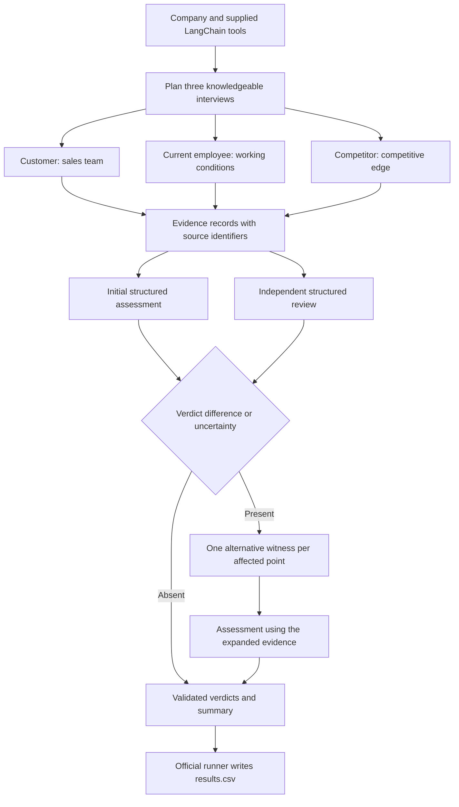

# FTEC5660 Homework 3

This repository implements a Fisher analysis agent for points 4, 7 and 11, using LangChain and the required DeepSeek model to produce evidence-based verdicts for each supplied company.

## Running the submission

Python 3.12 was used for development and validation, and the following commands prepare a clean environment before running the official entry point.

```bash
python -m venv .venv
```

Activate the environment with the command for your operating system.

```bash
source .venv/bin/activate
```

```powershell
.\.venv\Scripts\Activate.ps1
```

The exact installed package set is also recorded in `requirements-lock.txt` for reproducing the development environment. Install the dependencies, set the `DEEPSEEK_API_KEY` environment variable through your local credential configuration or a local `.env` file, and run the official command.

```bash
python -m pip install -r requirements.txt
python hw3.py --data-folder public_test
```

The official runner produces `results.csv`, containing the three verdicts, the number of correct points, any disagreements, the interview count and an explanatory summary for every company.

## Homework 3 solution

### Selected points and decision rules

The design follows Philip Fisher's *Common Stocks and Uncommon Profits*, Part One, Chapters 3 and 4, with particular attention to the use of knowledgeable outside sources when assessing business quality. The selected points cover customer service, employee relations and competitive positioning, providing three complementary areas of qualitative business evidence that can be assessed within the available interview budget.

**Point 4: Sales organization.** I selected this point because customers can describe the practical quality of account management and technical advice, allowing the agent to assess sales effectiveness through observed interactions. The agent returns PASS when a knowledgeable witness describes concrete capabilities such as useful technical advice, understanding of customer operations, proactive service or durable customer relationships; it returns FAIL when the evidence describes price-list distribution, basic order taking or customers seeking advice from competitors. The initial evidence comes from `interview(customer, sales_team)`, with a competitor interview available when additional evidence is required.

Fisher connects sustained business success with satisfied customers, repeat sales, careful sales training and continued improvements in service, which supports evaluating the quality of the sales relationship through customer experience. The rule therefore relies on described business practices and their implications for customer service, while the model handles variations in wording across companies.

**Point 7: Labour and personnel relations.** I selected this point because employee treatment provides observable evidence about retention, grievance handling and the working relationship between staff and management. The agent returns PASS when the evidence supports fair treatment and healthy personnel relations through fair pay, retention, responsive grievance handling or mutual respect; it returns FAIL when the evidence shows persistent excessive workload, frequent departures, unfair treatment or unresolved concerns. The initial evidence comes from `interview(current_employee, working_conditions)`, with a former employee available for additional evidence.

Fisher discusses worker attitudes, turnover, wage comparisons and the handling of grievances as useful indicators, while also emphasizing the need to consider the overall pattern of personnel relations. This rule uses positive evidence of healthy working practices and concrete evidence of persistent problems, keeping the assessment tied to the witness account.

**Point 11: Industry-specific competitive advantage.** I selected this point because competitor testimony can identify capabilities that influence the ability of rivals to reproduce products or win established customers. The agent returns PASS when a knowledgeable witness describes a specific advantage that supports a sustained competitive position, such as manufacturing knowledge, lengthy qualification, switching costs or specialist service; it returns FAIL when products are readily copied and competition depends mainly on price. The initial evidence comes from `interview(competitor, competitive_edge)`, with a customer available for additional evidence.

Fisher explains that the significance of a business capability depends on the industry and discusses manufacturing knowledge, customer relationships and continuing engineering improvements alongside patent protection. The rule preserves this industry context and allows several forms of durable advantage to support a favourable assessment.

### Agent design



The workflow uses fixed planning and routing because the assignment identifies which witnesses understand each topic, and each initial interview is requested through the supplied LangChain tool. A `ChatDeepSeek` model requests `deepseek-v4-flash`, processes the evidence through a structured LangChain runnable and returns one verdict, source reference, explanation and uncertainty flag for each point. The independent review receives the evidence and the same rules, with the initial verdicts excluded from its input, and the workflow compares both assessments after they finish. A difference in verdict or an uncertainty flag triggers one alternative witness for the affected point and one further assessment using all available evidence, allowing each company to finish with at most six interviews. The implementation executes the initial assessment before the independent review, while interviews and separate companies can run concurrently.

The workflow applies the course patterns of planning, routing, tool use, prompt chaining, parallelization and reflection, with four companies processed concurrently and a 150-second execution limit for each company. Each model request has a 35-second client timeout, each structured assessment has at most two attempts, and each company has separate evidence and execution records. Source identifiers are checked against the point and the available interview records, while schema validation requires all three selected points to occur exactly once. A failed additional review preserves the completed initial assessment, and a company with no completed assessment receives explicitly documented conservative FAIL values so the official runner can still produce its output.

### Public evaluation

The rules were written before the first complete public benchmark, and all company evidence was obtained through the supplied tools. The evaluation script reads `ground_truth.json` after inference to calculate the results, keeping the public answers outside the agent's reasoning input.

| Configuration | Correct verdicts | Balanced accuracy | Runtime in seconds | Model requests | Interviews |
| --- | ---: | ---: | ---: | ---: | ---: |
| Baseline | 60/60 | 100.0% | 14.587 | 20 | 60 |
| Reflection 1 | 60/60 | 100.0% | 24.489 | 40 | 60 |
| Reflection 2 | 60/60 | 100.0% | 24.872 | 40 | 60 |
| Reflection 3 | 60/60 | 100.0% | 22.975 | 40 | 60 |

The three reflection runs each achieved 60 correct verdicts from 60 decisions, with PASS recall and FAIL recall both reaching 100% in every run. Their mean balanced accuracy was 100%, and their mean runtime was 24.112 seconds, providing substantial room within the assignment's 30-minute limit. Each selected point had 14 public PASS cases and 6 public FAIL cases, and all three points were classified correctly in every recorded run.

The basic version already reached 100% balanced accuracy, so these measurements show equal public accuracy alongside the extra review cost. The final reflection runs used three interviews per company, and the initial assessments and independent reviews agreed on all verdicts with sufficient confidence to finish using the initial evidence. Targeted behavioural tests exercise the supplementary-interview branch and verify the alternative witness selection for a disputed point. Every recorded run finished with zero failed companies and zero degraded companies.

**Disagreements with the public answers:** All four benchmark runs produced an empty disagreement list, so the report has no public classification errors to attribute to a rule or evidence source. The independent review uses the same underlying model as the initial assessment, which leaves the possibility of correlated errors, and the public results provide evidence about the supplied examples while hidden-company accuracy remains unmeasured.

For a mixed example, Bramble Labs receives PASS on sales organization and personnel relations because the witnesses describe knowledgeable account service, fair pay, retention and responsive problem handling, while its competitive-edge evidence supports FAIL through readily copied products and competition on price. This example illustrates how the workflow keeps the three assessments separate when a company has strengths in some areas and a weakness in another.

The benchmarks were recorded on 9 November 2026, and the recorded results are available in [benchmark.csv](reports/benchmark.csv), [metrics.json](reports/metrics.json) and the four company-level result files in [reports](reports). The request parameter remains `deepseek-v4-flash` throughout the implementation, and the service returned `deepseek-flash` in response metadata during these tests; the implementation performs every request with the assignment's specified model identifier.

A fresh local clone was validated with a new virtual environment and a new dependency installation from `requirements.txt`, after which all ten behavioural tests passed and the official command produced 20 result rows with 60 correct verdicts from 60 decisions. That independent execution finished in 19.622 seconds with zero failed or degraded companies and three interviews per company, and its record is available in [fresh_clone_validation.json](reports/fresh_clone_validation.json).

### Reproducing the comparison

The following commands run the basic configuration once and the reflection configuration three times, saving aggregate metrics and company-level results under `reports` while local evidence traces remain under the ignored `.evaluation` directory.

```bash
python scripts/evaluate.py --mode baseline --runs 1
python scripts/evaluate.py --mode reflection --runs 3
python -m unittest discover -s tests -v
```

Ten local behavioural tests cover knowledgeable witness routing, selective supplementary interviews, unavailable witnesses, review failures, complete assessment failures, per-company timeout isolation, invalid source references, duplicate point validation, summary punctuation and contrast-free explanations. The code preserves the official tool, runner and scoring implementation, and every company evidence request passes through the provided tool interface.

### Task 2 reflection

The discussion of AI sycophancy and AI psychosis is included in [REFLECTION.md](REFLECTION.md), where the analysis considers preference learning, repeated validation, evidence quality and the limits of automated review.

### References

Philip A. Fisher, *Common Stocks and Uncommon Profits and Other Writings*, Wiley, 2003, Part One, Chapters 3 and 4. The course-provided digital reading was used for the interpretation of the selected points.

The supplied [assignment repository](https://github.com/BINH2702/FTEC5660-HW3) provides the tool interface, public companies and official evaluation procedure, while the [LangChain integration documentation](https://docs.langchain.com/oss/python/integrations/chat/deepseek) and [DeepSeek API documentation](https://api-docs.deepseek.com/guides/thinking_mode/) support the model integration and request configuration.
